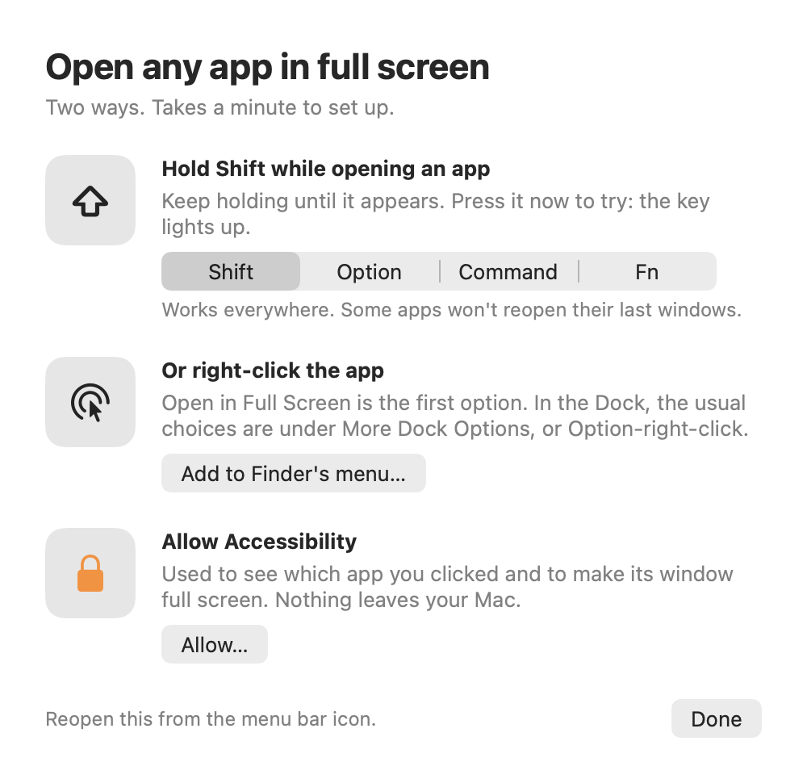

# FullOpen

Open any Mac app straight into full screen.

- **Right-click the app** in the Dock, Finder, Apps or Spotlight and choose **Open in Full Screen**.
- **Or hold Shift** while the app opens. You can change the key.
- **Or tick it once** under **Always Full Screen** in the menu bar.



## Install

Paste this in Terminal:

```bash
curl -fsSL https://raw.githubusercontent.com/Abhishek-programs/FullOpen/main/install.sh | zsh
```

It downloads the source, builds it on your Mac, puts FullOpen in **Applications** and opens it. [Read the script first](install.sh) if you like; it's short. Or clone the repo and run `./build.sh`.

Needs macOS 14 or later, Apple Silicon, and Apple's Command Line Tools (`xcode-select --install`). You don't need the full Xcode app.

The welcome screen then asks for two things:

1. **Accessibility**, so it can work at all.
2. **The Finder extension**, if you want the option in Finder's own menu.

The build is ad-hoc signed, so macOS forgets the Accessibility permission after every rebuild or update. Clear the stale entry, then allow it again:

```bash
tccutil reset Accessibility com.abhishek.fullopen
```

## What it does with Accessibility

Accessibility is a broad permission, so here is all of it:

- Finds the opened app's window and sets it to full screen.
- Listens for mouse clicks. On a right-click it checks whether an app in the Dock or a launcher is underneath. Other clicks pass through unchanged.
- Writes the names of apps you right-click there to the local system log.

It has no network code. It checks whether your hold key is down, and reads no other keys. The source is about 500 lines of Swift with no dependencies.

## How it works

macOS has no way to add an item to the Dock's right-click menu. So for the Dock and launchers, FullOpen catches the right-click first and shows its own standard menu with **Open in Full Screen** at the top.

- Apple's original Dock menu is under **More Dock Options…**
- **Option-right-click** skips FullOpen and gives you the original menu anywhere.
- Finder does allow menu items, so there it's a normal Finder extension.

| File | Job |
|---|---|
| `main.swift` | Menu bar, launch detection, full screen |
| `RightClick.swift` | Finds the app under the cursor, shows the menu |
| `Welcome.swift` | Welcome screen and key picker |
| `FinderMenu/` | Finder extension |

`.build/FullOpen --check` runs the self-check. `build.sh` runs it on every build.

## Known limits

- The hold key only works for apps that aren't already running. Right-click works for both.
- Holding Shift can stop an app from reopening its last windows. Pick another key or use Always Full Screen.
- Apps that don't support full screen stay windowed.
- Not notarized. Built and tested on one Mac running macOS 27.

## License

[MIT](LICENSE)
